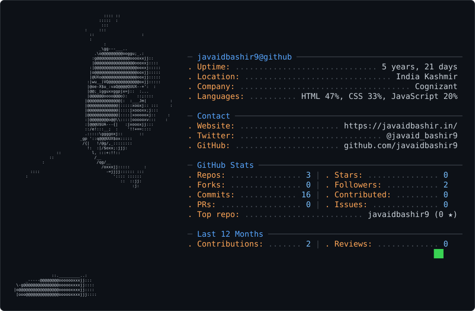

# 💫 About Me:
### About Me  - 🔭 I’m currently working as a **Subject Matter Expert (SME) at Cognizant**, supporting Google Cloud Platform (GCP) and helping teams resolve complex technical issues. - 👯 I’m looking to collaborate on **cloud computing, GCP projects, web development, automation, and open-source initiatives. - 🤝 I’m looking for help with **advancing my cloud engineering skills, exploring cloud automation, and building scalable technology solutions. - 🌱 I’m currently learning **cloud technologies, data analytics, cloud operations, and modern web development practices. - 💬 Ask me about **Google Cloud Platform (GCP), Google Workspace, technical troubleshooting, root cause analysis, DNS, SSL, web hosting, WordPress, HTML, CSS, JavaScript, PHP, MySQL, and data analysis**. - ⚡ Fun fact: **I enjoy turning complex technical problems into simple solutions, building websites, and continuously exploring new technologies.

<picture>
  <source media="(prefers-color-scheme: dark)" srcset="dark_mode.svg" />
  <source media="(prefers-color-scheme: light)" srcset="light_mode.svg" />
  
</picture>

## 🌐 Socials:
     

# 💻 Tech Stack:
                         
# 📊 GitHub Stats:
 
 

## 🏆 GitHub Trophies

### ✍️ Random Dev Quote

### 🔝 Top Contributed Repo

---

<!-- Proudly created with GPRM ( https://gprm.itsvg.in ) -->
